# eslee Folder Locker

Current version: **v2.0.0** — [changes, verification and limits](.github/release-notes/v2.0.0.md).

A Windows program that locks and unlocks folders with a password. A locked folder does not open in File Explorer until you unlock it with the password.

[⬇️ **Download the latest release**](https://github.com/esleeeeee/eslee-folder-locker/releases/latest)

**Document language:** [한국어](README.md) · English

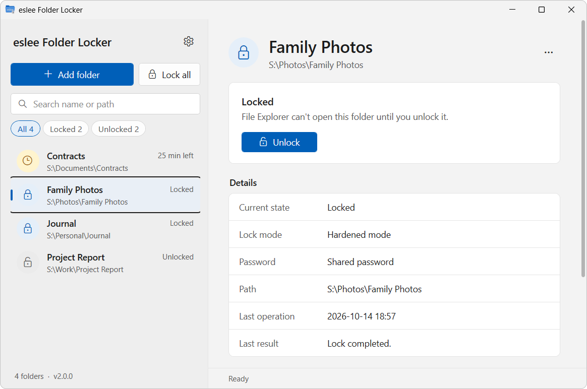

## Introduction

A program for keeping folders on your PC locked.

- It changes the folder's Windows access permissions (ACL) so your current account cannot open it. The permissions from before the lock are backed up and restored when you unlock.

> **Note:** It does not encrypt files. The lock can be bypassed in principle, so use BitLocker or a separate Windows account as well for important data.

## Features

- Lock and unlock folders with a password
- **Temporary unlock**: keep a folder open for 1 minute to 1 day, then it locks again automatically
- **Lock all**: lock every open folder at once
- A notice with an Unlock button when you open a locked folder in File Explorer
- A separate password for a single folder (optional)
- Light and dark themes, Korean and English

## 1. Install

1. On the [latest release page](https://github.com/esleeeeee/eslee-folder-locker/releases/latest), download the file with `setup` in its name (`eslee-folder-locker-setup-v<version>.exe`).
   - `Source code (zip)` and `Source code (tar.gz)` are source code archives; you do not need them.
   - `...-win-x64.zip` runs without installing. Use the `setup` file unless you have a reason not to.
2. Run the downloaded file.
3. If **Windows protected your PC** appears, select **More info** → **Run anyway**.
   The warning appears because the installer has no code signature. Make sure you downloaded it from the official page above.
4. Go through the setup wizard. Optionally select (you can change both later in Settings):
   - **Create a desktop shortcut**
   - **Start automatically at Windows login (in the tray)** — starts quietly in the system tray when you sign in.

> Requirements: Windows 11 (64-bit) and an NTFS drive. If you are asked to install .NET 8 on first start, follow the prompt.

## 2. First start: set the master recovery password

On first start, this window appears.

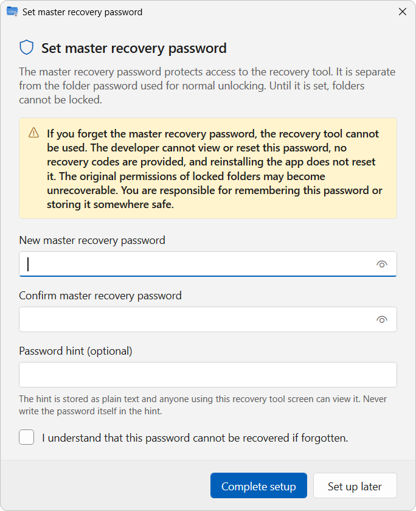

The **master recovery password** does not unlock folders. It is an emergency password that opens the **recovery tool** when something goes wrong.

1. Enter the same value in **New master recovery password** and **Confirm master recovery password**.
2. **Password hint** is optional. Other people can see the hint, so never write the password itself.
3. Select **I understand that this password cannot be recovered if forgotten.** and select **Complete setup**.

> **Important:** A forgotten master recovery password cannot be recovered. There is no password reset, no recovery code, and reinstalling does not reset it.
>
> You can skip with **Set up later**, but you cannot lock folders until this password is set.

## 3. Lock a folder

### Add a folder

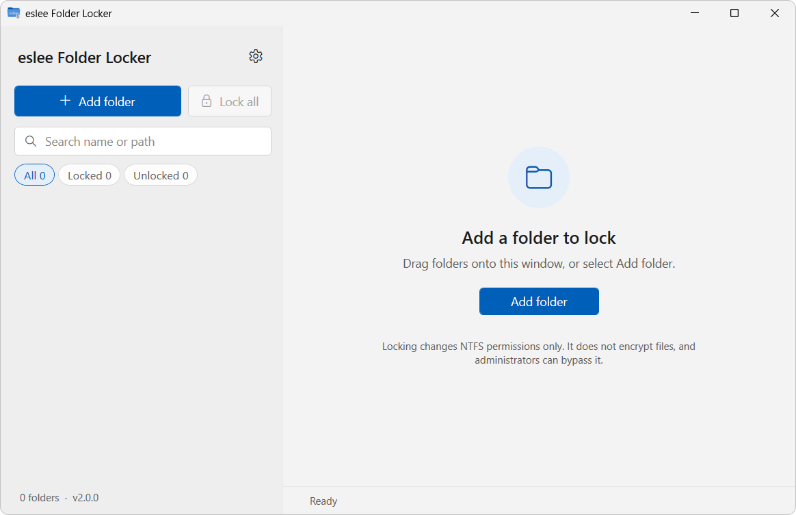

Select **Add folder** and choose the folder to lock. You can also drag a folder from File Explorer onto the window.

When you add your first folder, you set the **folder password**. This is the password for unlocking; it needs at least 4 characters and is shared by all folders.

> Whole drives (such as `C:\`), the Windows folder, Program Files, a whole user folder (`C:\Users\<name>`), and the top OneDrive folder cannot be locked. Ordinary folders inside them can.

### Choose a lock mode and lock

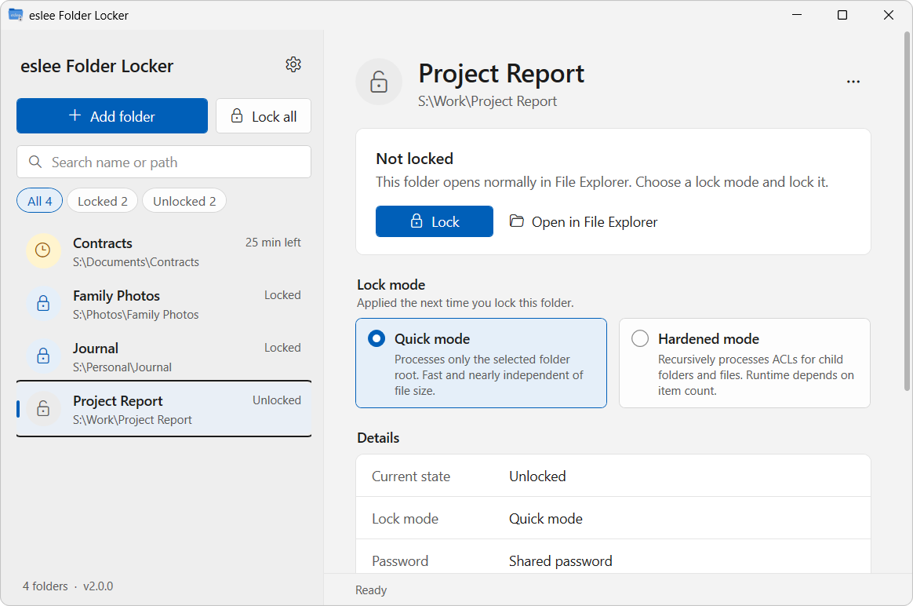

1. Select the folder in the list on the left.
2. Choose a **Lock mode** on the right.
   - **Quick mode** (recommended): restricts only the folder itself. It finishes right away regardless of how many files there are and is enough in most cases.
   - **Hardened mode**: restricts every file and subfolder one by one. It takes longer when there are many files.
3. Select **Lock** and confirm.
4. When **Do you want to allow this app to make changes to your device?** (UAC, the administrator confirmation) appears, select **Yes**. Changing folder permissions requires administrator approval.
5. When the state in the list changes to **Locked**, you are done. The folder no longer opens in File Explorer.

## Main window

The main window has the **folder list** on the left and **details of the selected folder** on the right (top picture).

| Item | What it does |
|---|---|
| **Add folder** | Registers a folder to lock |
| **Lock all** | Locks every unlocked folder at once, with a single UAC confirmation |
| Search box | Finds folders by name or path (`Ctrl+F`) |
| **All / Locked / Unlocked** | Filters the list by state. **Needs attention** appears when a folder has a problem |
| State on the right of each folder | **Locked**, **Unlocked**, **25 min left** (temporary unlock), and so on |
| Gear | Opens Settings |
| **⋯** (right of the folder name) | Open in File Explorer, set a password for this folder, remove the folder |
| **Details / Recent activity** | Lock mode, path, last operation, and the lock and unlock history. Passwords are never recorded |

### Right-click menu in the list

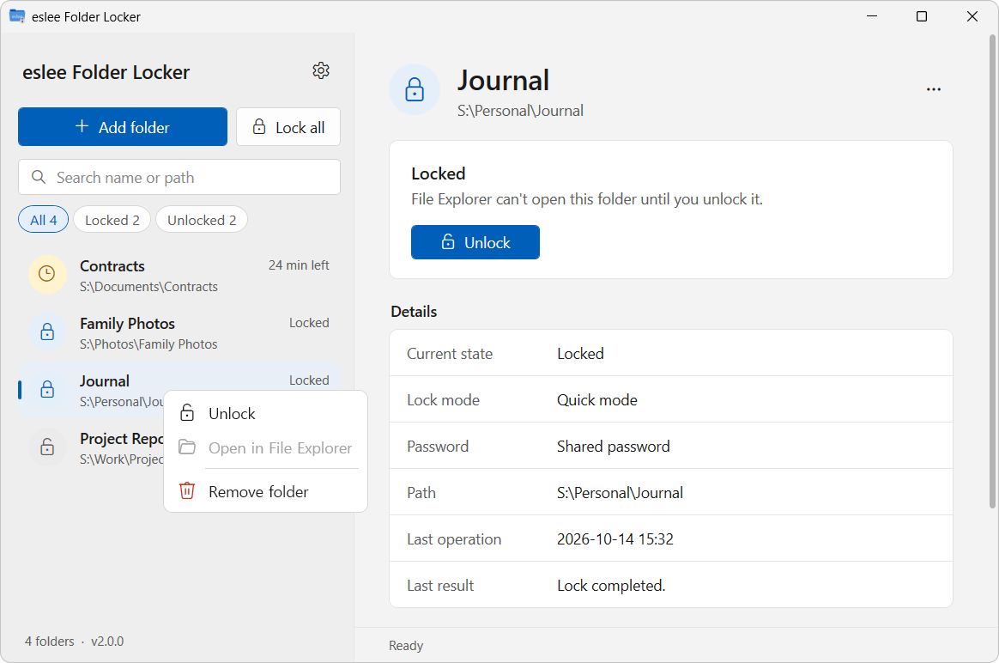

Right-click a folder in the list to run common actions directly. Only the actions that fit the folder's state are shown (for example, **Unlock** for a locked folder).

## 4. Unlock

### In the app

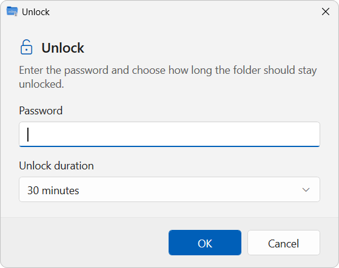

1. Select a locked folder in the list and select **Unlock**.
2. Enter the folder password.
3. Choose the **Unlock duration**.
   - **1 minute / 5 minutes / 10 minutes / 30 minutes / 1 hour / 1 day**: the folder locks again automatically when the time is up.
   - **Unlock permanently**: the folder stays open until you lock it again.
4. Select **OK** and then **Yes** in the UAC window. The folder is unlocked and opens in File Explorer.

A wrong password changes nothing. There is no limit on attempts.

### From File Explorer

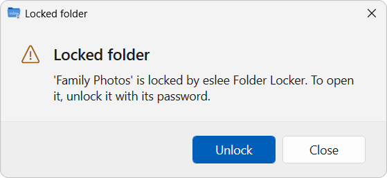

While the app is running, opening a locked folder in File Explorer shows the notice above instead of the Windows "You don't currently have permission" dialog. **Unlock** leads to the password window.

You can also unlock from the right-click menu.

1. Right-click the locked folder.
2. On Windows 11, select **Show more options** (or hold `Shift` while right-clicking).
3. Select **Unlock with eslee Folder Locker**.

> Only code-signed packaged apps can add entries to the first page of the Windows 11 right-click menu, so this entry is under **Show more options**.

## 5. Temporary unlock

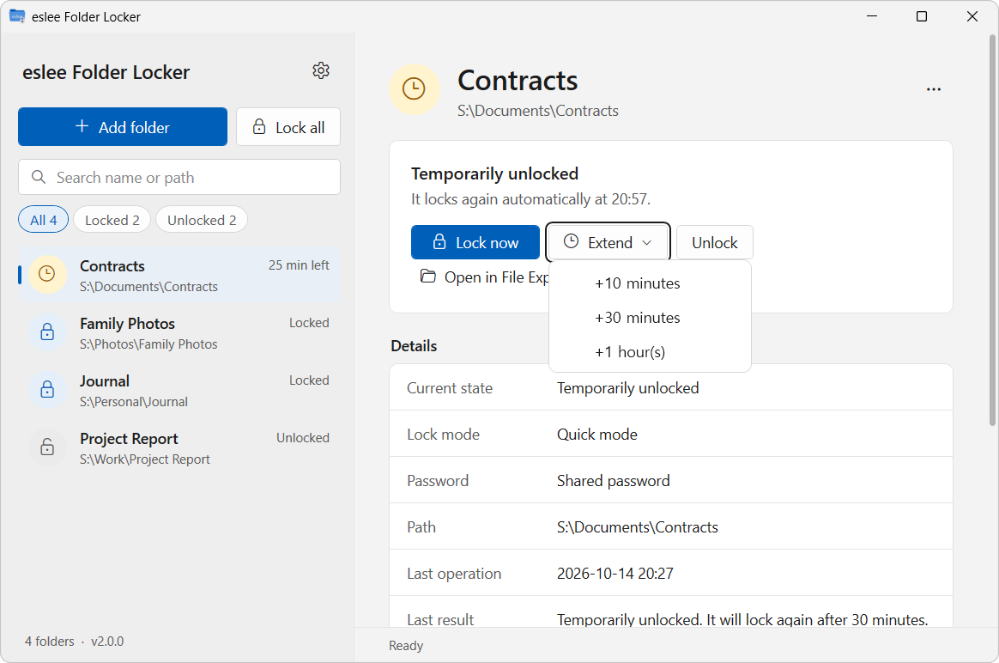

When you unlock for a set time, the list shows the time left (for example `25 min left`) and the folder locks again automatically when the time is up. While it is temporarily unlocked you can use these buttons; neither asks for UAC again.

- **Lock now**: locks right away, whatever time is left.
- **Extend**: adds **+10 minutes / +30 minutes / +1 hour** (up to one day from now).

Good to know:

- If you turn off the PC while time is left, the folder is locked again the next time you sign in to Windows.
- Temporary unlock is available only after the master recovery password is set. Permanent unlock is always available.
- With **Settings > Automatic locking** turned on, temporarily unlocked folders lock again right away when you lock the PC (`Win+L`) or it goes to sleep.

## Settings

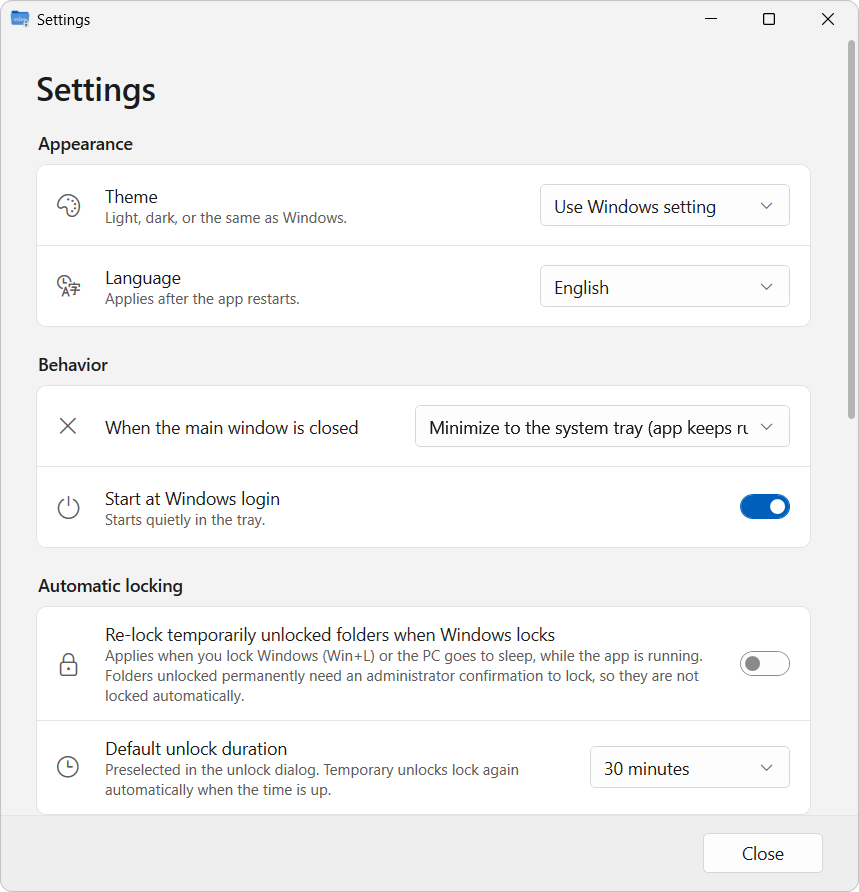

Open it with the gear. Changes apply immediately; there is no Save button.

| Item | Description |
|---|---|
| **Appearance > Theme** | Use Windows setting / Light / Dark |
| **Appearance > Language** | Use Windows setting / 한국어 / English (applies after the app restarts) |
| **Behavior > When the main window is closed** | Minimize to the system tray, or exit the app completely |
| **Behavior > Start at Windows login** | Starts in the system tray when you sign in |
| **Automatic locking** | Re-locks temporarily unlocked folders when you lock the PC (`Win+L`) or it sleeps |
| **Automatic locking > Default unlock duration** | The duration preselected in the unlock window |
| **Security** | Change the folder password, change the master recovery password and hint, open the recovery tool |
| **File Explorer** | Register or remove the right-click menu, show this app's notice for locked folders, view the operation log |

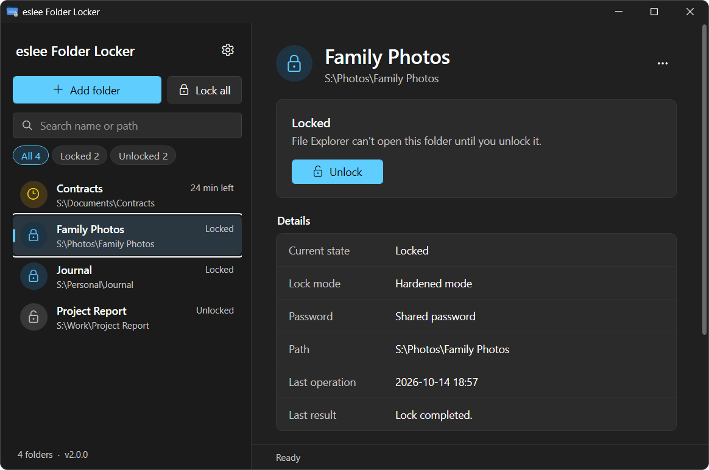

The main window in the dark theme.

## System tray

- Selecting **X** on the window does not exit the program; it hides in the notification area at the right of the taskbar (the system tray). No notification is shown.
- **Double-click** the tray icon to open the window again.
- **Right-click** the tray icon for locked folders, **Lock all**, the recovery tool, Settings, and **Exit**.
- To exit completely, select **Exit** in the tray menu.
- If you use eslee Tray Folder, the app appears in the Tray Folder menu instead of having its own tray icon.

## Passwords

| Password | Used for | If you forget it |
|---|---|---|
| **Folder password** | Unlocking folders (app, File Explorer, tray) | Use the recovery tool with the master recovery password to restore the folder's permissions |
| **Master recovery password** | Opening the recovery tool | It cannot be recovered |

- Neither password can be used in place of the other.
- To use a different password for one folder, select **Set a password for this folder** in the **⋯** menu. **Use the shared password again** switches back at any time.
- Select the eye icon on the right of a password box to see what you typed.

## Troubleshooting

**I selected "No" in the UAC window.**
Nothing was changed. Run the same action again and select **Yes**.

**The program disappeared when I selected X.**
It is hidden in the system tray. Double-click its icon at the right of the taskbar. To exit with X instead, change **Settings > Behavior > When the main window is closed**.

**I cannot add a folder.**
Whole drives, the Windows folder, Program Files, a whole user folder, and the top OneDrive folder cannot be registered. USB flash drives and drives that are not NTFS (FAT32, exFAT, and so on) are not supported either.

**The list shows "Not found".**
The folder was moved or renamed, or the external disk that holds it is not connected. Move it back or connect the disk to use it again.

**The unlock entry is missing from the File Explorer right-click menu.**
On Windows 11, select **Show more options** or use `Shift`+right-click. If it is still missing, select **Settings > File Explorer > Register Explorer menu**.

**A temporarily unlocked folder did not lock again.**
If the PC was off, it is locked at the next sign-in. To lock it right away, select **Lock now**. If the problem repeats, check the errors with **Settings > File Explorer > View logs**.

**I forgot the master recovery password.**
It cannot be recovered. If you know the folder password, normal unlocking still works.

**Uninstalling warns that there are locked folders.**
Unlock all folders permanently in the app, then uninstall. If you already uninstalled, reinstall and continue unlocking.

If the problem remains, describe the symptom and the steps to reproduce it in [GitHub Issues](https://github.com/esleeeeee/eslee-folder-locker/issues). Remove personal folder names and paths before attaching logs.

## Recovery tool

A separate program for when unlocking in the app does not work.

- Start it from **Settings > Security > Open recovery tool**, the tray menu, or **eslee Folder Locker Recovery Tool** in the Start menu.
- After the UAC confirmation you must enter the **master recovery password**. No folder information is shown before you are authenticated.
- Choose the folder and backup, type `RESTORE` as instructed, and the folder's permissions return to their state before the lock.
- It does not recover forgotten passwords.

See the [recovery guide](docs/recovery-guide.md) for details.

## Updating and uninstalling

- **Update**: run the new installer. Registered folders, passwords, and settings are kept.
- **Uninstall**: remove the app from the app list in Windows Settings. You are warned if locked folders remain, so unlock them first.
- Uninstalling keeps your data (`%LOCALAPPDATA%\eslee-folder-locker`), so a reinstall continues where you left off.

> **Caution:** Do not delete the `%LOCALAPPDATA%\eslee-folder-locker` folder yourself. It holds the permission backups from before each lock; without them, locked folders may not be restorable.

## Privacy

- No account, ads, or usage statistics.
- The only internet access is the update check. It reads GitHub's public release information and sends nothing from your PC, and it never installs updates on its own.
- All data is stored in `%LOCALAPPDATA%\eslee-folder-locker`.
  - Passwords are never stored in plain text; only verification values (hash and salt) are stored.
  - The master recovery password hint is stored as typed.
  - Permission backups from before each lock and the operation log (including folder paths) are stored.

## Limitations

- Files are not encrypted. Administrators, users who know how to change permissions, and anyone reading the disk from another operating system are not stopped.
- Locking, unlocking, and recovery need UAC approval. Just opening the app does not.
- The installer has no code signature, so SmartScreen may warn on first run.
- See the [limitations document](docs/limitations.md) for details.

## How it works

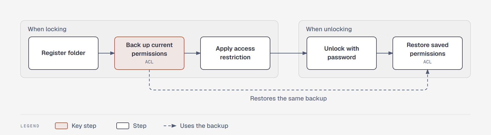

1. Before locking, the folder's Windows access permissions (ACL) are backed up.
2. A restriction is added so the current user account cannot access the folder.
3. Unlocking removes the added restriction and restores the backed-up permissions.
4. If something goes wrong, the recovery tool restores the permissions from the saved backup.

See the [architecture document](docs/architecture.md) and the [ACL design document](docs/acl-design.md) for internals.

## For developers

Building requires the .NET 8 SDK.

```powershell
git clone https://github.com/esleeeeee/eslee-folder-locker.git
Set-Location eslee-folder-locker
dotnet build .\FolderGate.sln -c Release
dotnet test .\FolderGate.sln --filter "TestCategory!=RequiresElevation"
```

The Korean and English UI come from the same build and are selected with `AppText.SetLanguage`. The single installer is built with `installer\Build-Installers.ps1 -Version 2.0.0` (requires Inno Setup 6).

- [Architecture](docs/architecture.md) — project structure, data paths, master password design
- [ACL design](docs/acl-design.md) — how permissions are changed
- [Recovery guide](docs/recovery-guide.md) — recovery tool in detail
- [Limitations](docs/limitations.md) — limits of the security model
- [Test results](docs/test-results.md) — how tests are run and what they cover
- [CHANGELOG](CHANGELOG.md) — changes per version

The internal project name and namespaces stay `FolderGate` for compatibility. This project was developed entirely by vibe coding with AI coding agents. The screenshots were taken with sample folders.

## License

Released under the [MIT License](LICENSE). You may use, modify, and distribute it freely as long as the copyright notice and license text are included. The software is provided "as is", without warranty of any kind.
