# eslee Folder Locker

현재 릴리스 준비 버전: **v2.0.0** — [변경·검증·제한](.github/release-notes/v2.0.0.md).

내 PC의 폴더를 **비밀번호로 잠그는** 프로그램이에요. 잠긴 폴더는 파일 탐색기에서 열리지 않고, 비밀번호를 넣어야 다시 열 수 있어요.

[⬇️ **최신 버전 다운로드**](https://github.com/esleeeeee/eslee-folder-locker/releases/latest)

**문서 언어:** 한국어 · [English](README.en.md)

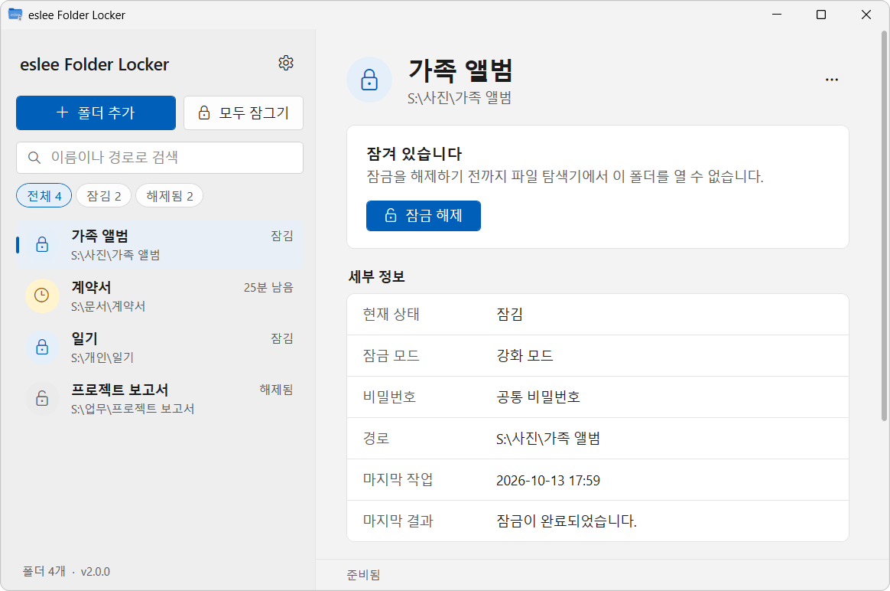

## 이런 프로그램이에요

- 가족이나 친구와 **PC 한 대를 같이 쓸 때**, 보여 주고 싶지 않은 폴더를 잠가 둘 수 있어요.
- 파일은 **원래 자리에 그대로** 있어요. 옮기거나 지우거나 바꾸지 않아요.
- 잠그는 방법은 Windows의 "폴더 출입 권한"을 바꾸는 거예요. 문에 자물쇠를 다는 것과 비슷해요. 잠그기 전 권한은 따로 저장해 두었다가, 풀 때 그대로 되돌려요.

> **꼭 알아 두세요**
>
> 이 프로그램은 파일을 **암호화하지 않아요.** 자물쇠를 다는 것이지 금고에 넣는 것이 아니에요. 컴퓨터를 잘 아는 사람이 관리자 권한을 쓰면 열 수 있어요. 정말 중요한 자료는 BitLocker(드라이브 암호화)나 Windows 계정을 따로 쓰는 방법을 함께 쓰세요.

## 할 수 있는 일

- 폴더 **잠그기 / 풀기** (비밀번호 필요)
- **잠깐만 풀기**: 1분~하루 동안만 열어 두고, 시간이 지나면 **자동으로 다시 잠가요**
- **모두 잠그기**: 열려 있는 폴더를 버튼 하나로 한꺼번에 잠가요
- 파일 탐색기에서 잠긴 폴더를 열면 **바로 풀 수 있는 안내 창**이 떠요
- 폴더마다 **다른 비밀번호**를 정할 수도 있어요 (선택)
- 밝은 화면 / **어두운 화면(다크 모드)**, 한국어 / English

## 1단계. 내려받고 설치하기

1. [최신 버전 페이지](https://github.com/esleeeeee/eslee-folder-locker/releases/latest)를 열어요.
2. 이름에 `setup`이 들어간 파일(`eslee-folder-locker-setup-v버전.exe`)을 내려받아요.
   - `Source code (zip)`, `Source code (tar.gz)`는 **프로그램 코드 묶음**이라 받을 필요 없어요.
   - `...-win-x64.zip`은 설치 없이 쓰는 버전이에요. 잘 모르겠으면 `setup` 파일을 받으세요.
3. 내려받은 파일을 실행해요.
4. 파란색 **"Windows의 PC 보호"** 창이 뜨면 **추가 정보** → **실행**을 눌러요.
   이 프로그램은 유료 인증서(코드 서명)가 없어서 이 창이 뜰 수 있어요. 반드시 위 공식 페이지에서 받은 파일인지 먼저 확인하세요.
5. 설치 창에서 **다음**을 눌러 설치해요. 원하면 이 두 가지를 켤 수 있어요(나중에 바꿀 수 있어요).
   - **바탕화면 바로가기 만들기**
   - **Windows 로그인 시 자동 실행** (켜 두면 PC를 켤 때 조용히 같이 켜져요)

> 필요한 환경: Windows 11(64비트), NTFS 드라이브. 처음 실행할 때 .NET 8 설치 안내가 나오면 안내대로 설치하세요.

## 2단계. 처음 실행: 마스터 복구 비밀번호 정하기

처음 켜면 아래 창이 나와요.

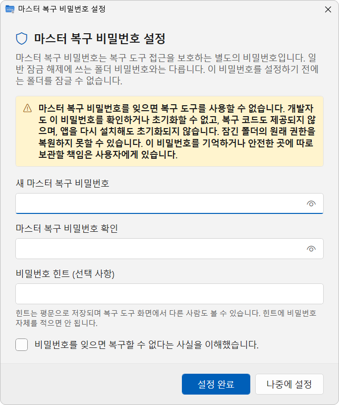

**마스터 복구 비밀번호**는 폴더를 여는 비밀번호가 **아니에요.** 프로그램에 문제가 생겼을 때 쓰는 **비상용 비밀번호**예요.

1. **새 마스터 복구 비밀번호**와 **확인** 칸에 같은 비밀번호를 넣어요.
2. 힌트는 넣어도 되고 비워도 돼요. **힌트에 비밀번호 자체를 쓰면 안 돼요.** (힌트는 누구나 볼 수 있어요.)
3. **비밀번호를 잊으면 복구할 수 없다는 사실을 이해했습니다**를 체크하고 **설정 완료**를 눌러요.

> **이 비밀번호는 잊으면 절대 되찾을 수 없어요.** 비밀번호 찾기도, 초기화도 없어요. 프로그램을 다시 설치해도 그대로예요. 꼭 기억하거나 안전한 곳에 적어 두세요.
>
> **나중에 설정**을 눌러 건너뛸 수도 있지만, 이 비밀번호를 정하기 전에는 폴더를 잠글 수 없어요.

## 3단계. 폴더 잠그기

### ① 잠글 폴더 추가하기

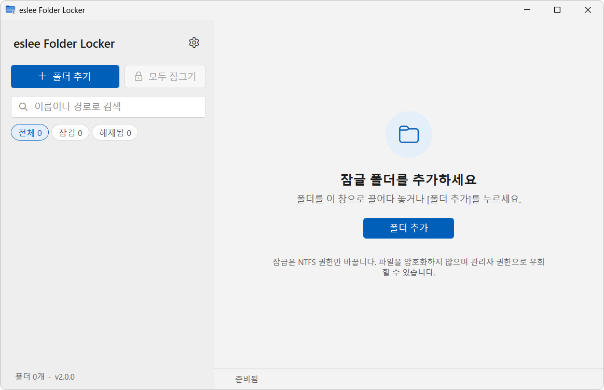

**폴더 추가**를 눌러 잠글 폴더를 골라요. 파일 탐색기에서 폴더를 이 창으로 **끌어다 놓아도** 돼요.

처음 폴더를 추가하면 **폴더 비밀번호**를 정하는 창이 나와요. 이게 폴더를 열 때 쓰는 비밀번호예요. (4자 이상, 모든 폴더에 공통으로 써요.)

> `C:\` 같은 드라이브 전체, Windows 폴더, Program Files, 사용자 폴더 전체(`C:\Users\이름`), OneDrive 최상위 폴더처럼 위험한 곳은 잠글 수 없게 막혀 있어요. 그 안에 있는 일반 폴더는 잠글 수 있어요.

### ② 잠금 모드 고르고 잠그기

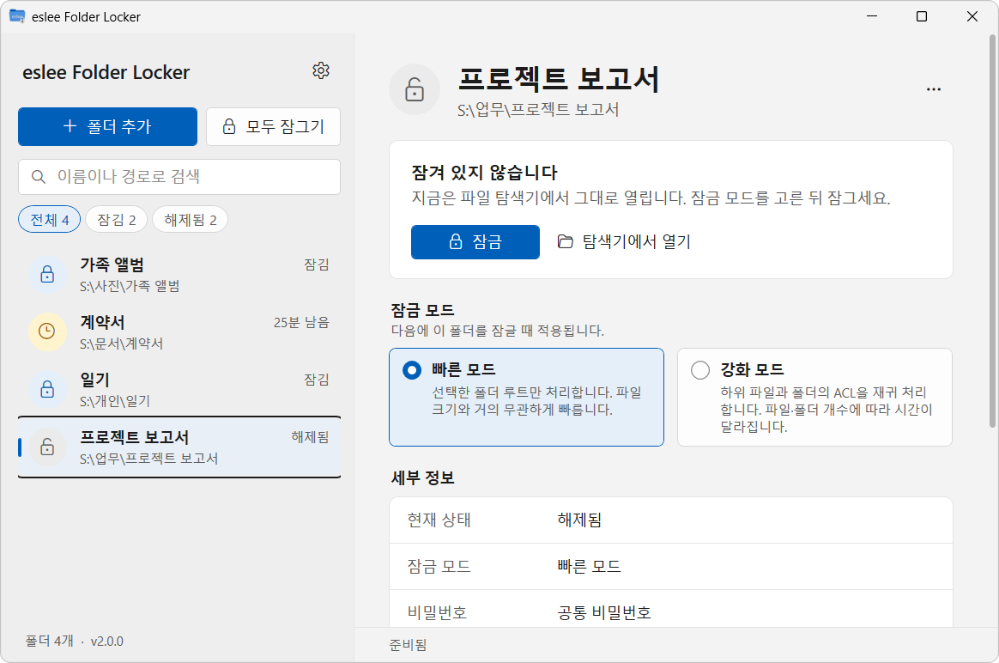

1. 왼쪽 목록에서 폴더를 눌러요.
2. 오른쪽에서 **잠금 모드**를 골라요.
   - **빠른 모드** (추천): 폴더 입구만 잠가요. 파일이 많아도 금방 끝나요. 대부분 이걸로 충분해요.
   - **강화 모드**: 폴더 안의 파일과 하위 폴더까지 하나하나 잠가요. 파일이 많으면 오래 걸려요.
3. **잠금**을 누르고 확인 창에서 다시 확인해요.
4. **"이 앱이 디바이스를 변경하도록 허용하시겠어요?"** 창(관리자 확인 창, UAC)이 뜨면 **예**를 눌러요. 폴더 권한을 바꾸려면 Windows가 이렇게 한 번 더 물어봐요.
5. 목록에서 폴더 상태가 **잠김**으로 바뀌면 끝이에요. 이제 파일 탐색기에서 이 폴더가 열리지 않아요.

## 화면 둘러보기

맨 위 사진처럼 **왼쪽은 폴더 목록**, **오른쪽은 고른 폴더의 정보**예요.

| 부분 | 하는 일 |
|---|---|
| **폴더 추가** | 잠글 폴더를 등록해요 |
| **모두 잠그기** | 열려 있는 폴더를 한 번에 잠가요 (관리자 확인 창은 한 번만 떠요) |
| 검색 칸 | 폴더 이름이나 경로로 찾아요 (`Ctrl+F`) |
| **전체 / 잠김 / 해제됨** | 목록을 상태별로 걸러 봐요. 문제가 있는 폴더가 있으면 **확인 필요**가 생겨요 |
| 목록의 오른쪽 글자 | 지금 상태예요: **잠김**, **해제됨**, **25분 남음**(잠깐 풀어 둔 폴더) |
| 톱니바퀴 | 설정을 열어요 |
| **⋯** (폴더 이름 오른쪽) | 탐색기에서 열기, 이 폴더만 다른 비밀번호 쓰기, 목록에서 빼기 |
| **최근 기록** (오른쪽 아래) | 그 폴더를 언제 잠그고 풀었는지 보여 줘요. 비밀번호는 기록하지 않아요 |

### 목록에서 오른쪽 클릭

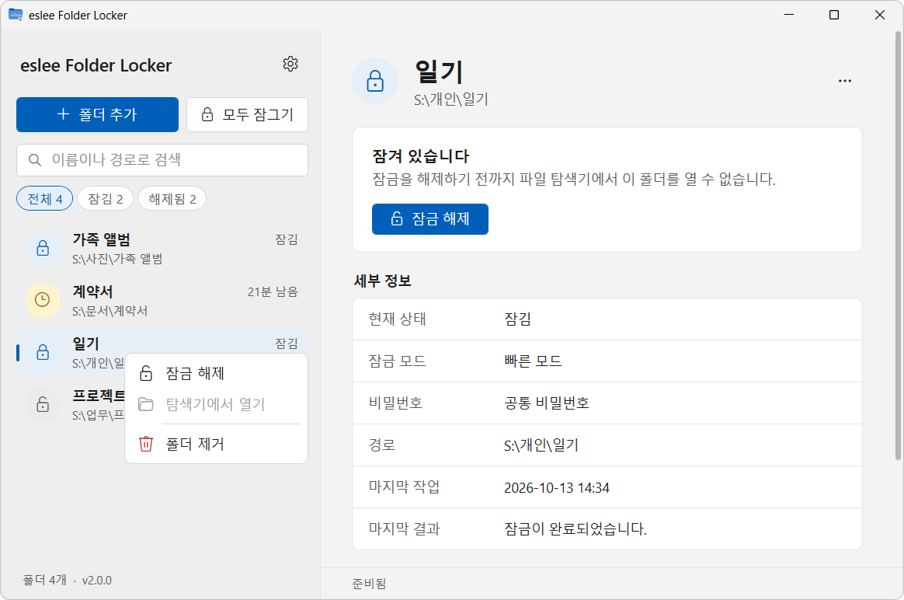

목록에서 폴더를 **오른쪽 클릭**하면 자주 쓰는 기능이 바로 나와요. 그 폴더 상태에 맞는 것만 보여요. 예를 들어 잠긴 폴더에는 **잠금 해제**가 보여요.

## 4단계. 잠금 풀기

### 앱에서 풀기

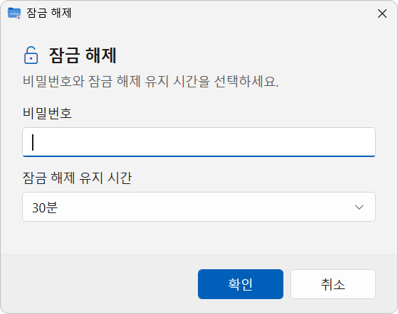

1. 목록에서 잠긴 폴더를 고르고 **잠금 해제**를 눌러요.
2. **폴더 비밀번호**를 넣어요.
3. **잠금 해제 유지 시간**을 골라요.
   - **1분 / 5분 / 10분 / 30분 / 1시간 / 하루**: 그 시간이 지나면 **자동으로 다시 잠겨요.**
   - **완전 해제**: 내가 다시 잠글 때까지 계속 열려 있어요.
4. **확인**을 누르고 관리자 확인 창에서 **예**를 누르면, 폴더가 풀리고 탐색기로 바로 열려요.

> 비밀번호가 틀리면 아무것도 바뀌지 않아요. 몇 번 틀려도 잠기거나 기다릴 필요는 없어요.

### 파일 탐색기에서 풀기

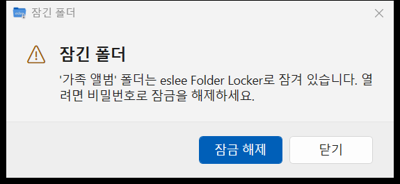

앱이 켜져 있을 때 탐색기에서 잠긴 폴더를 열면, Windows의 "권한이 없습니다" 창 대신 **이 안내 창**이 떠요. **잠금 해제**를 누르면 위와 같은 비밀번호 창이 나와요.

탐색기에서 폴더를 **오른쪽 클릭**해서 풀 수도 있어요.

1. 잠긴 폴더를 오른쪽 클릭해요.
2. Windows 11에서는 **더 많은 옵션 표시**를 누르세요. (`Shift`를 누른 채 오른쪽 클릭하면 바로 나와요.)
3. **eslee Folder Locker로 잠금 해제**를 눌러요.

> Windows 11의 새 오른쪽 클릭 메뉴 첫 화면에는 유료 인증서로 서명한 프로그램만 들어갈 수 있어서, 이 메뉴는 **더 많은 옵션 표시** 안에 있어요.

## 5단계. 잠깐만 풀어 두기 (시간제 해제)

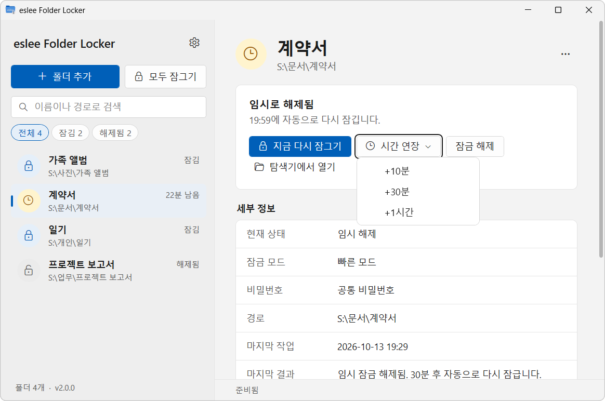

시간을 정해서 풀면 목록에 **남은 시간**(예: `25분 남음`)이 보이고, 시간이 다 되면 저절로 다시 잠겨요. 풀어 둔 동안에는 이 두 버튼을 쓸 수 있어요. 둘 다 관리자 확인 창이 다시 뜨지 않아요.

- **지금 다시 잠그기**: 기다리지 않고 바로 잠가요.
- **시간 연장**: **+10분 / +30분 / +1시간**을 더해요. (지금부터 최대 하루까지)

알아 두면 좋은 점:

- 시간이 남았는데 PC를 끄면, **다음에 Windows에 로그인할 때** 다시 잠가요.
- 시간제 해제는 2단계의 **마스터 복구 비밀번호를 정한 뒤에만** 쓸 수 있어요. 완전 해제는 언제나 쓸 수 있어요.
- **설정 > 자동 잠금**을 켜면, `Win+L`로 PC를 잠그거나 절전 모드에 들어갈 때 잠깐 풀어 둔 폴더가 **바로** 다시 잠겨요.

## 설정

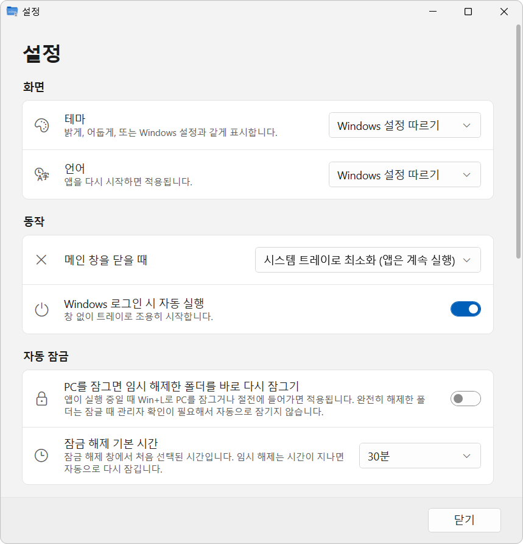

톱니바퀴를 누르면 열려요. 바꾸면 **바로 저장**돼요(저장 버튼이 없어요).

| 항목 | 설명 |
|---|---|
| **화면 > 테마** | Windows 설정 따르기 / 라이트 / 다크 |
| **화면 > 언어** | Windows 설정 따르기 / 한국어 / English (앱을 다시 켜면 적용) |
| **동작 > 메인 창을 닫을 때** | X를 누르면 트레이로 숨길지, 완전히 끌지 |
| **동작 > Windows 로그인 시 자동 실행** | PC를 켤 때 조용히 같이 켜져요 |
| **자동 잠금** | PC를 잠그거나(`Win+L`) 절전할 때 잠깐 풀어 둔 폴더를 바로 다시 잠가요 |
| **자동 잠금 > 잠금 해제 기본 시간** | 잠금 해제 창에서 처음부터 골라져 있을 시간 |
| **보안** | 폴더 비밀번호 바꾸기, 마스터 복구 비밀번호·힌트 바꾸기, 복구 도구 열기 |
| **파일 탐색기** | 오른쪽 클릭 메뉴 등록/제거, 잠긴 폴더를 열 때 앱 안내 표시 켜기/끄기, 작업 로그 보기 |

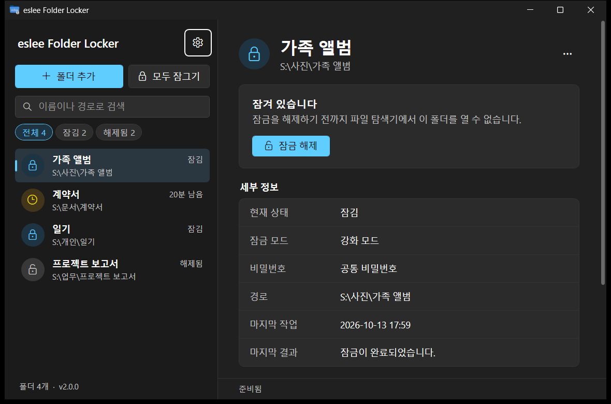

어두운 테마(다크 모드)는 이렇게 보여요.

## 창을 닫으면 어디로 가나요? (트레이)

- 창의 **X**를 눌러도 프로그램은 꺼지지 않고, 작업 표시줄 오른쪽의 **작은 아이콘 영역(트레이)**으로 숨어요. 알림은 따로 뜨지 않아요.
- 트레이 아이콘을 **두 번 클릭**하면 창이 다시 열려요.
- 트레이 아이콘을 **오른쪽 클릭**하면 잠긴 폴더 바로 풀기, **모두 잠그기**, 설정, **종료**가 있어요.
- 프로그램을 완전히 끄려면 트레이 메뉴의 **종료**를 누르세요.
- eslee Tray Folder를 쓰고 있으면, 아이콘이 따로 생기지 않고 Tray Folder 안에 들어가요.

## 비밀번호가 두 개예요

| 비밀번호 | 언제 써요? | 잊으면? |
|---|---|---|
| **폴더 비밀번호** | 폴더를 풀 때 (앱, 탐색기, 트레이) | 마스터 복구 비밀번호로 복구 도구를 써서 폴더 권한을 되돌릴 수 있어요 |
| **마스터 복구 비밀번호** | 복구 도구를 열 때 | **되찾을 방법이 없어요** |

- 두 비밀번호는 서로 대신 쓸 수 없어요.
- 폴더마다 다른 비밀번호를 쓰고 싶으면, 폴더 이름 옆 **⋯** 메뉴에서 **이 폴더 전용 비밀번호 설정**을 고르세요. **공통 비밀번호로 되돌리기**로 언제든 돌아갈 수 있어요.
- 비밀번호 칸 오른쪽의 눈 모양 아이콘을 누르면 입력한 글자를 볼 수 있어요.

## 문제가 생겼을 때

**관리자 확인 창에서 실수로 "아니요"를 눌렀어요.**
→ 아무것도 바뀌지 않았어요. 같은 버튼을 다시 누르고 이번엔 **예**를 누르세요.

**X를 눌렀더니 프로그램이 사라졌어요.**
→ 꺼진 게 아니라 트레이로 숨은 거예요. 작업 표시줄 오른쪽 아이콘을 두 번 클릭하세요. X로 완전히 끄고 싶으면 **설정 > 동작 > 메인 창을 닫을 때**를 바꾸세요.

**폴더를 추가할 수 없어요.**
→ 드라이브 전체, Windows 폴더, Program Files, 사용자 폴더 전체, OneDrive 최상위 폴더는 막혀 있어요. USB 메모리와 NTFS가 아닌 드라이브(FAT32, exFAT 등)도 안 돼요. 그 안의 일반 폴더나 내장 디스크의 폴더를 골라 보세요.

**목록에 "찾을 수 없음"이라고 나와요.**
→ 폴더를 옮겼거나 이름을 바꿨거나, 외장 디스크를 뺀 거예요. 제자리로 돌려놓거나 디스크를 연결하면 다시 쓸 수 있어요.

**탐색기 오른쪽 클릭 메뉴에 "eslee Folder Locker로 잠금 해제"가 없어요.**
→ Windows 11에서는 **더 많은 옵션 표시**를 누르거나 `Shift + 오른쪽 클릭`하세요. 그래도 없으면 **설정 > 파일 탐색기 > 탐색기 메뉴 등록**을 누르세요.

**잠깐 풀어 뒀는데 다시 안 잠겼어요.**
→ PC가 꺼져 있었다면 다음 로그인 때 잠가요. 급하면 앱에서 **지금 다시 잠그기**를 누르세요. 그래도 안 되면 **설정 > 파일 탐색기 > 로그 보기**에서 오류를 확인하세요.

**마스터 복구 비밀번호를 잊었어요.**
→ 되찾을 방법이 없어요. 하지만 **폴더 비밀번호를 알면 폴더를 푸는 건 계속 할 수 있어요.**

**프로그램을 지우려는데 "잠긴 폴더가 있다"고 나와요.**
→ 먼저 앱에서 모든 폴더를 **완전 해제**한 뒤 지우세요. 이미 지웠다면 다시 설치하면 이어서 풀 수 있어요.

해결이 안 되면 [GitHub Issues](https://github.com/esleeeeee/eslee-folder-locker/issues)에 증상과 순서를 적어 주세요. 로그를 올릴 때는 개인 폴더 이름과 경로를 지우고 올려 주세요.

## 복구 도구 (비상용)

앱에서 폴더가 안 풀릴 때 쓰는 **비상용 프로그램**이에요.

- **설정 > 보안 > 복구 도구 열기**, 트레이 메뉴, 또는 시작 메뉴의 **eslee Folder Locker 복구 도구**로 열어요.
- 관리자 확인 창에서 **예**를 누른 뒤 **마스터 복구 비밀번호**를 넣어야 해요. 비밀번호를 맞히기 전에는 아무 정보도 보이지 않아요.
- 폴더와 백업을 고르고, 안내대로 `RESTORE`를 입력하면 폴더 권한을 잠그기 전으로 되돌려요.
- 잊어버린 비밀번호를 찾아 주는 도구는 **아니에요.**

자세한 방법은 [복구 가이드](docs/recovery-guide.md)를 보세요.

## 업데이트와 지우기

- **업데이트**: 새 설치 파일을 그냥 실행하면 돼요. 폴더 목록, 비밀번호, 설정은 그대로 남아요.
- **지우기**: Windows 설정의 앱 목록에서 지워요. 잠긴 폴더가 남아 있으면 경고가 뜨니, 먼저 모두 풀어 주세요.
- 지워도 내 데이터(`%LOCALAPPDATA%\eslee-folder-locker` 폴더)는 남아요. 다시 설치하면 그대로 이어서 쓸 수 있어요.

> **주의:** `%LOCALAPPDATA%\eslee-folder-locker` 폴더를 직접 지우면 안 돼요. 여기에 잠그기 전 권한 백업이 있어서, 지우면 잠긴 폴더를 되돌리지 못할 수 있어요.

## 개인정보

- 회원가입, 광고, 사용 기록 수집이 **없어요.**
- 인터넷은 **새 버전 확인** 한 가지에만 써요. GitHub의 공개 정보를 보기만 하고, 내 PC의 정보는 보내지 않아요. 자동 업데이트도 하지 않아요.
- 모든 데이터는 내 PC의 `%LOCALAPPDATA%\eslee-folder-locker`에 저장돼요.
  - 비밀번호 **원문은 저장하지 않아요.** 맞는지 확인하는 값(hash)만 저장해요.
  - 마스터 복구 비밀번호 **힌트**는 적은 그대로 저장돼요.
  - 잠그기 전 권한 백업과 작업 기록(폴더 경로 포함)이 저장돼요.

## 한계 (솔직하게)

- 파일을 암호화하지 않아요. 관리자 권한을 쓰는 사람, 권한 설정을 다룰 줄 아는 사람, 다른 운영체제로 디스크를 읽는 사람은 막지 못해요.
- 잠그고 풀 때 관리자 확인 창(UAC)에서 **예**를 눌러야 해요. 평소에 앱을 보는 것만으로는 필요 없어요.
- 설치 파일에 코드 서명이 없어서 처음에 Windows 경고가 뜰 수 있어요.
- 더 자세한 내용은 [제한사항 문서](docs/limitations.md)를 보세요.

## 작동 원리

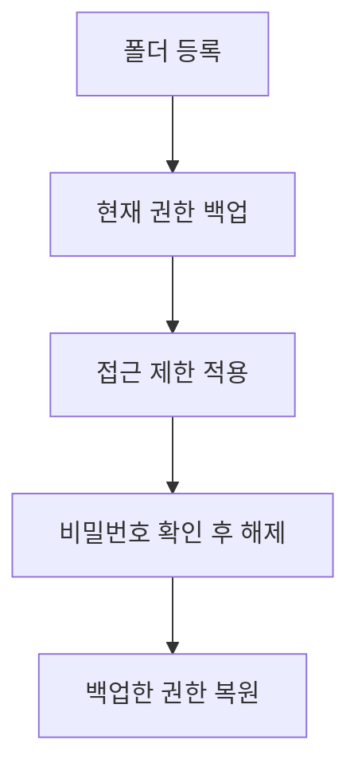

1. 잠그기 전에 폴더의 Windows 접근 권한(ACL)을 백업해요.
2. 현재 사용자 계정이 폴더에 들어가지 못하도록 제한을 추가해요.
3. 풀 때는 추가한 제한을 없애고 백업한 권한을 되돌려요.
4. 문제가 생기면 복구 도구가 저장된 백업으로 권한을 되돌려요.

자세한 내부 구조는 [아키텍처 문서](docs/architecture.md)와 [ACL 설계 문서](docs/acl-design.md)를 참고하세요.

## 개발자용 문서

빌드하려면 .NET 8 SDK가 필요합니다.

```powershell
git clone https://github.com/esleeeeee/eslee-folder-locker.git
Set-Location eslee-folder-locker
dotnet build .\FolderGate.sln -c Release
dotnet test .\FolderGate.sln --filter "TestCategory!=RequiresElevation"
```

한국어/영어 UI는 같은 빌드에서 `AppText.SetLanguage`로 선택합니다. 설치 파일 하나는 `installer\Build-Installers.ps1 -Version 2.0.0`으로 생성합니다(Inno Setup 6 필요).

- [아키텍처](docs/architecture.md) — 프로젝트 구조, 데이터 경로, 마스터 비밀번호 설계
- [ACL 설계](docs/acl-design.md) — 권한 변경 방식
- [복구 가이드](docs/recovery-guide.md) — 복구 도구 상세 사용법
- [제한사항](docs/limitations.md) — 보안 모델의 한계
- [테스트 결과](docs/test-results.md) — 테스트 실행 방법과 범위
- [CHANGELOG](CHANGELOG.md) — 버전별 변경 이력

내부 프로젝트명과 네임스페이스는 호환성을 위해 `FolderGate`를 유지합니다. 이 프로젝트는 전 과정을 AI 코딩 에이전트와의 바이브코딩으로 개발했습니다.

화면 사진은 예시 폴더로 찍은 것이에요.

## 라이선스

현재 별도의 라이선스 파일이 제공되지 않습니다.
