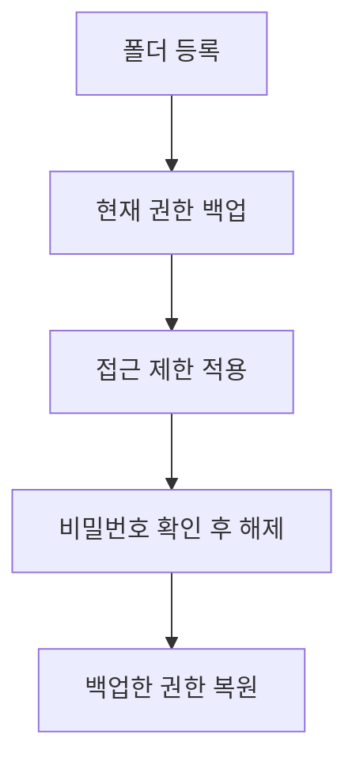

# eslee Folder Locker

현재 릴리스 준비 버전: **v2.0.0** — [변경·검증·제한](.github/release-notes/v2.0.0.md).

Windows 폴더를 비밀번호로 잠그고 해제하는 프로그램입니다. 잠긴 폴더는 파일 탐색기에서 열리지 않으며, 비밀번호를 입력해야 다시 열 수 있습니다.

[⬇️ **최신 버전 다운로드**](https://github.com/esleeeeee/eslee-folder-locker/releases/latest)

**문서 언어:** 한국어 · [English](README.en.md)


## 소개

PC 내 폴더를 잠가 두는 용도의 프로그램입니다.

- Windows의 폴더 접근 권한(ACL)을 바꿔 현재 계정이 폴더를 열지 못하게 합니다. 잠그기 전의 권한은 백업해 두었다가 해제할 때 되돌립니다.

> **참고:** 파일 자체를 프로그램은 아닙니다. 이론상 잠금 우회가 가능하므로, 중요한 자료에는 BitLocker나 별도의 Windows 계정을 함께 사용하세요.

## 주요 기능

- 폴더 잠금과 해제 (비밀번호 사용)
- **임시 해제**: 1분~하루 동안만 열어 두고, 시간이 지나면 자동으로 다시 잠금
- **모두 잠그기**: 열려 있는 폴더를 한 번에 잠금
- 파일 탐색기에서 잠긴 폴더를 열면 바로 해제할 수 있는 안내 창 표시
- 폴더별 비밀번호 지정 (선택)
- 라이트/다크 테마, 한국어/English

## 1. 설치

1. [최신 버전 페이지](https://github.com/esleeeeee/eslee-folder-locker/releases/latest)에서 이름에 `setup`이 들어간 파일(`eslee-folder-locker-setup-v버전.exe`)을 내려받습니다.
   - `Source code (zip)`, `Source code (tar.gz)`는 소스 코드 묶음이므로 받지 않아도 됩니다.
   - `...-win-x64.zip`은 설치 없이 쓰는 버전입니다. 특별한 이유가 없다면 `setup` 파일을 사용하세요.
2. 내려받은 파일을 실행합니다.
3. **Windows의 PC 보호** 창이 나타나면 **추가 정보** → **실행**을 누릅니다.
   설치 파일에 코드 서명이 없어서 표시되는 경고입니다. 위의 공식 페이지에서 받은 파일인지 먼저 확인하세요.
4. 설치 마법사를 진행합니다. 필요하면 다음 항목을 선택합니다(나중에 설정에서 바꿀 수 있습니다).
   - **바탕화면 바로가기 만들기**
   - **Windows 로그인 시 자동 실행** — PC를 켤 때 트레이에서 조용히 시작합니다.

> 지원 환경: Windows 11(64비트), NTFS 드라이브. 실행할 때 .NET 8 설치 안내가 나오면 안내에 따라 설치하세요.

## 2. 처음 실행: 마스터 복구 비밀번호 설정

처음 실행하면 아래 창이 나타납니다.


**마스터 복구 비밀번호**는 폴더를 여는 비밀번호가 아니라, 문제가 생겼을 때 **복구 도구**를 여는 데 쓰는 비상용 비밀번호입니다.

1. **새 마스터 복구 비밀번호**와 **마스터 복구 비밀번호 확인**에 같은 값을 입력합니다.
2. **비밀번호 힌트**는 선택 사항입니다. 힌트는 다른 사람도 볼 수 있으므로 비밀번호 자체를 적지 마세요.
3. **비밀번호를 잊으면 복구할 수 없다는 사실을 이해했습니다**를 선택하고 **설정 완료**를 누릅니다.

> **중요:** 마스터 복구 비밀번호는 잊어버리면 되찾을 수 없습니다. 비밀번호 찾기, 초기화, 복구 코드가 없고 다시 설치해도 초기화되지 않습니다.
>
> **나중에 설정**으로 건너뛸 수 있지만, 이 비밀번호를 설정하기 전에는 폴더를 잠글 수 없습니다.

## 3. 폴더 잠그기

### 폴더 추가


**폴더 추가**를 눌러 잠글 폴더를 선택합니다. 파일 탐색기에서 폴더를 창으로 끌어다 놓아도 됩니다.

처음 폴더를 추가할 때 **폴더 비밀번호**를 정합니다. 폴더를 해제할 때 쓰는 비밀번호이며, 4자 이상이어야 하고 모든 폴더에 공통으로 사용됩니다.

> 드라이브 전체(`C:\` 등), Windows 폴더, Program Files, 사용자 폴더 전체(`C:\Users\이름`), OneDrive 최상위 폴더는 잠글 수 없습니다. 그 안에 있는 일반 폴더는 잠글 수 있습니다.

### 잠금 모드 선택과 잠금


1. 왼쪽 목록에서 폴더를 선택합니다.
2. 오른쪽에서 **잠금 모드**를 고릅니다.
   - **빠른 모드**(권장): 폴더 자체에만 제한을 겁니다. 파일 수와 관계없이 바로 끝나며, 대부분의 경우 이것으로 충분합니다.
   - **강화 모드**: 하위 파일과 폴더 하나하나에 제한을 겁니다. 파일이 많으면 시간이 걸립니다.
3. **잠금**을 누르고 확인 창에서 내용을 확인합니다.
4. **이 앱이 디바이스를 변경하도록 허용하시겠어요?**(UAC, 관리자 권한 확인) 창이 나타나면 **예**를 누릅니다. 폴더 권한을 바꾸려면 관리자 승인이 필요합니다.
5. 목록의 상태가 **잠김**으로 바뀌면 완료입니다. 이제 파일 탐색기에서 이 폴더가 열리지 않습니다.

## 화면 구성

메인 창은 왼쪽 **폴더 목록**과 오른쪽 **선택한 폴더의 정보**로 나뉩니다(맨 위 사진).

| 항목 | 설명 |
|---|---|
| **폴더 추가** | 잠글 폴더를 등록합니다 |
| **모두 잠그기** | 해제된 폴더를 한 번에 잠급니다. UAC 확인은 한 번만 표시됩니다 |
| 검색 상자 | 폴더 이름이나 경로로 찾습니다 (`Ctrl+F`) |
| **전체 / 잠김 / 해제됨** | 상태별로 목록을 걸러 봅니다. 문제가 있는 폴더가 있으면 **확인 필요**가 추가됩니다 |
| 목록 오른쪽의 상태 | **잠김**, **해제됨**, **25분 남음**(임시 해제) 등 현재 상태를 표시합니다 |
| 톱니바퀴 | 설정을 엽니다 |
| **⋯** (폴더 이름 오른쪽) | 탐색기에서 열기, 폴더 전용 비밀번호 설정, 폴더 제거 |
| **세부 정보 / 최근 기록** | 잠금 모드, 경로, 마지막 작업과 잠금·해제 기록을 보여 줍니다. 비밀번호는 기록하지 않습니다 |

### 목록 우클릭 메뉴


목록에서 폴더를 우클릭하면 자주 쓰는 기능을 바로 실행할 수 있습니다. 폴더 상태에 맞는 항목만 표시됩니다(예: 잠긴 폴더에는 **잠금 해제**).

## 4. 잠금 해제

### 앱에서 해제


1. 목록에서 잠긴 폴더를 선택하고 **잠금 해제**를 누릅니다.
2. 폴더 비밀번호를 입력합니다.
3. **잠금 해제 유지 시간**을 고릅니다.
   - **1분 / 5분 / 10분 / 30분 / 1시간 / 하루**: 시간이 지나면 자동으로 다시 잠깁니다.
   - **완전 해제**: 다시 잠글 때까지 열려 있습니다.
4. **확인**을 누르고 UAC 창에서 **예**를 누르면 폴더가 해제되고 파일 탐색기로 열립니다.

비밀번호가 틀리면 권한은 바뀌지 않습니다. 입력 횟수 제한은 없습니다.

### 파일 탐색기에서 해제


앱이 실행 중일 때 파일 탐색기에서 잠긴 폴더를 열면, Windows의 "권한이 없습니다" 창 대신 위 안내 창이 나타납니다. **잠금 해제**를 누르면 비밀번호 입력 창으로 이어집니다.

우클릭 메뉴로도 해제할 수 있습니다.

1. 잠긴 폴더를 우클릭합니다.
2. Windows 11에서는 **더 많은 옵션 표시**를 누릅니다(`Shift`를 누른 채 우클릭하면 바로 표시됩니다).
3. **eslee Folder Locker로 잠금 해제**를 선택합니다.

> Windows 11의 새 우클릭 메뉴 첫 화면에는 코드 서명된 패키지 앱만 항목을 추가할 수 있어, 이 메뉴는 **더 많은 옵션 표시** 안에 있습니다.

## 5. 임시 해제


시간을 정해 해제하면 목록에 남은 시간(예: `25분 남음`)이 표시되고, 시간이 지나면 자동으로 다시 잠깁니다. 임시 해제 중에는 다음 버튼을 쓸 수 있으며, 둘 다 UAC 확인이 다시 나타나지 않습니다.

- **지금 다시 잠그기**: 남은 시간과 관계없이 바로 잠급니다.
- **시간 연장**: **+10분 / +30분 / +1시간**을 추가합니다(지금부터 최대 하루까지).

알아 둘 점:

- 시간이 남은 상태에서 PC를 끄면, 다음에 Windows에 로그인할 때 다시 잠급니다.
- 임시 해제는 마스터 복구 비밀번호를 설정한 뒤에만 사용할 수 있습니다. 완전 해제는 항상 사용할 수 있습니다.
- **설정 > 자동 잠금**을 켜면 `Win+L`로 PC를 잠그거나 절전 모드에 들어갈 때 임시 해제한 폴더를 바로 다시 잠급니다.

## 설정


톱니바퀴를 눌러 엽니다. 변경 사항은 저장 버튼 없이 바로 적용됩니다.

| 항목 | 설명 |
|---|---|
| **화면 > 테마** | Windows 설정 따르기 / 라이트 / 다크 |
| **화면 > 언어** | Windows 설정 따르기 / 한국어 / English (앱을 다시 시작하면 적용) |
| **동작 > 메인 창을 닫을 때** | 트레이로 숨기기 또는 완전히 종료 |
| **동작 > Windows 로그인 시 자동 실행** | 로그인할 때 트레이에서 시작 |
| **자동 잠금** | PC를 잠그거나(`Win+L`) 절전할 때 임시 해제한 폴더를 바로 다시 잠금 |
| **자동 잠금 > 잠금 해제 기본 시간** | 잠금 해제 창에서 처음 선택되어 있는 시간 |
| **보안** | 폴더 비밀번호 변경, 마스터 복구 비밀번호·힌트 변경, 복구 도구 열기 |
| **파일 탐색기** | 우클릭 메뉴 등록/제거, 잠긴 폴더 안내 표시, 작업 로그 보기 |


다크 테마를 적용한 화면입니다.

## 시스템 트레이

- 창의 **X**를 누르면 프로그램이 종료되지 않고 작업 표시줄 오른쪽 아이콘 영역(트레이)으로 숨겨집니다. 알림은 표시되지 않습니다.
- 트레이 아이콘을 **더블 클릭**하면 창이 다시 열립니다.
- 트레이 아이콘을 **우클릭**하면 잠긴 폴더 해제, **모두 잠그기**, 복구 도구, 설정, **종료** 메뉴를 쓸 수 있습니다.
- 완전히 종료하려면 트레이 메뉴의 **종료**를 누릅니다.
- eslee Tray Folder를 사용 중이면 별도의 트레이 아이콘 대신 Tray Folder 메뉴 안에 표시됩니다.

## 비밀번호 종류

| 비밀번호 | 용도 | 잊어버렸을 때 |
|---|---|---|
| **폴더 비밀번호** | 폴더 해제 (앱, 탐색기, 트레이) | 마스터 복구 비밀번호로 복구 도구를 실행해 폴더 권한을 되돌릴 수 있습니다 |
| **마스터 복구 비밀번호** | 복구 도구 실행 | 되찾을 방법이 없습니다 |

- 두 비밀번호는 서로 대신 사용할 수 없습니다.
- 폴더마다 다른 비밀번호를 쓰려면 **⋯** 메뉴에서 **이 폴더 전용 비밀번호 설정**을 선택합니다. **공통 비밀번호로 되돌리기**로 언제든 돌아갈 수 있습니다.
- 비밀번호 입력란 오른쪽의 눈 모양 아이콘을 누르면 입력한 내용을 확인할 수 있습니다.

## 문제 해결

**UAC 창에서 "아니요"를 눌렀습니다.**
권한은 바뀌지 않았습니다. 같은 작업을 다시 실행하고 **예**를 누르세요.

**X를 눌렀더니 프로그램이 사라졌습니다.**
트레이로 숨겨진 상태입니다. 작업 표시줄 오른쪽의 아이콘을 더블 클릭하세요. X를 눌렀을 때 바로 종료되게 하려면 **설정 > 동작 > 메인 창을 닫을 때**를 바꿉니다.

**폴더를 추가할 수 없습니다.**
드라이브 전체, Windows 폴더, Program Files, 사용자 폴더 전체, OneDrive 최상위 폴더는 등록할 수 없습니다. USB 메모리와 NTFS가 아닌 드라이브(FAT32, exFAT 등)도 지원하지 않습니다.

**목록에 "찾을 수 없음"이 표시됩니다.**
폴더를 옮기거나 이름을 바꿨거나, 폴더가 있던 외장 디스크가 연결되어 있지 않은 경우입니다. 원래 위치로 되돌리거나 디스크를 연결하면 다시 사용할 수 있습니다.

**탐색기 우클릭 메뉴에 해제 항목이 없습니다.**
Windows 11에서는 **더 많은 옵션 표시**를 누르거나 `Shift`+우클릭을 사용하세요. 그래도 없으면 **설정 > 파일 탐색기 > 탐색기 메뉴 등록**을 누릅니다.

**임시 해제한 폴더가 다시 잠기지 않았습니다.**
PC가 꺼져 있었다면 다음 로그인 때 다시 잠급니다. 바로 잠그려면 **지금 다시 잠그기**를 누르세요. 문제가 반복되면 **설정 > 파일 탐색기 > 로그 보기**에서 오류를 확인합니다.

**마스터 복구 비밀번호를 잊었습니다.**
되찾을 방법은 없습니다. 폴더 비밀번호를 알고 있다면 일반 잠금 해제는 계속 사용할 수 있습니다.

**제거할 때 "잠긴 폴더가 있습니다" 경고가 나옵니다.**
앱에서 모든 폴더를 **완전 해제**한 뒤 제거하세요. 이미 제거했다면 다시 설치해 이어서 해제할 수 있습니다.

해결되지 않으면 [GitHub Issues](https://github.com/esleeeeee/eslee-folder-locker/issues)에 증상과 재현 순서를 남겨 주세요. 로그를 첨부할 때는 개인 폴더 이름과 경로를 지워 주세요.

## 복구 도구

앱에서 잠금 해제가 정상적으로 되지 않을 때 사용하는 별도 프로그램입니다.

- **설정 > 보안 > 복구 도구 열기**, 트레이 메뉴, 시작 메뉴의 **eslee Folder Locker 복구 도구**로 실행합니다.
- UAC 확인 후 **마스터 복구 비밀번호**를 입력해야 하며, 인증 전에는 폴더 정보가 표시되지 않습니다.
- 복구할 폴더와 백업을 선택하고 안내에 따라 `RESTORE`를 입력하면 잠그기 전의 권한으로 되돌립니다.
- 잊어버린 비밀번호를 찾아 주는 도구는 아닙니다.

자세한 사용법은 [복구 가이드](docs/recovery-guide.md)를 참고하세요.

## 업데이트와 제거

- **업데이트**: 새 설치 파일을 실행하면 됩니다. 등록한 폴더, 비밀번호, 설정은 그대로 유지됩니다.
- **제거**: Windows 설정의 앱 목록에서 제거합니다. 잠긴 폴더가 남아 있으면 경고가 나타나므로, 먼저 모두 해제하세요.
- 제거해도 사용자 데이터(`%LOCALAPPDATA%\eslee-folder-locker`)는 남아 있어, 다시 설치하면 이어서 사용할 수 있습니다.

> **주의:** `%LOCALAPPDATA%\eslee-folder-locker` 폴더를 직접 삭제하지 마세요. 잠그기 전 권한의 백업이 들어 있어, 삭제하면 잠긴 폴더를 되돌리지 못할 수 있습니다.

## 개인정보

- 계정 가입, 광고, 사용 통계 수집이 없습니다.
- 인터넷 연결은 새 버전 확인에만 사용합니다. GitHub의 공개 Release 정보를 조회할 뿐 PC의 정보는 전송하지 않으며, 자동 업데이트도 하지 않습니다.
- 데이터는 모두 `%LOCALAPPDATA%\eslee-folder-locker`에 저장됩니다.
  - 비밀번호 원문은 저장하지 않고, 확인용 값(hash와 salt)만 저장합니다.
  - 마스터 복구 비밀번호 힌트는 입력한 그대로 저장됩니다.
  - 잠그기 전 권한 백업과 작업 로그(폴더 경로 포함)가 저장됩니다.

## 제한 사항

- 파일을 암호화하지 않습니다. 관리자 권한 사용자, 권한 설정을 다룰 줄 아는 사용자, 다른 운영체제로 디스크를 읽는 경우는 막지 못합니다.
- 잠금, 해제, 복구에는 UAC 승인이 필요합니다. 앱을 열어 보는 것만으로는 필요하지 않습니다.
- 설치 파일에 코드 서명이 없어 처음 실행할 때 SmartScreen 경고가 표시될 수 있습니다.
- 자세한 내용은 [제한사항 문서](docs/limitations.md)를 참고하세요.

## 작동 원리



1. 잠그기 전에 폴더의 Windows 접근 권한(ACL)을 백업합니다.
2. 현재 사용자 계정이 폴더에 접근하지 못하도록 제한을 추가합니다.
3. 해제할 때는 추가한 제한을 제거하고 백업한 권한을 되돌립니다.
4. 문제가 생기면 복구 도구가 저장된 백업으로 권한을 복원합니다.

자세한 내부 구조는 [아키텍처 문서](docs/architecture.md)와 [ACL 설계 문서](docs/acl-design.md)를 참고하세요.

## 개발자용 문서

빌드하려면 .NET 8 SDK가 필요합니다.

```powershell
git clone https://github.com/esleeeeee/eslee-folder-locker.git
Set-Location eslee-folder-locker
dotnet build .\FolderGate.sln -c Release
dotnet test .\FolderGate.sln --filter "TestCategory!=RequiresElevation"
```

한국어/영어 UI는 같은 빌드에서 `AppText.SetLanguage`로 선택합니다. 설치 파일 하나는 `installer\Build-Installers.ps1 -Version 2.0.0`으로 생성합니다(Inno Setup 6 필요).

- [아키텍처](docs/architecture.md) — 프로젝트 구조, 데이터 경로, 마스터 비밀번호 설계
- [ACL 설계](docs/acl-design.md) — 권한 변경 방식
- [복구 가이드](docs/recovery-guide.md) — 복구 도구 상세 사용법
- [제한사항](docs/limitations.md) — 보안 모델의 한계
- [테스트 결과](docs/test-results.md) — 테스트 실행 방법과 범위
- [CHANGELOG](CHANGELOG.md) — 버전별 변경 이력

내부 프로젝트명과 네임스페이스는 호환성을 위해 `FolderGate`를 유지합니다. 이 프로젝트는 전 과정을 AI 코딩 에이전트와의 바이브코딩으로 개발했습니다. 화면 사진은 예시 폴더로 촬영했습니다.

## 라이선스

[MIT 라이선스](LICENSE)로 배포합니다. 누구나 자유롭게 사용·수정·배포할 수 있으며, 배포할 때는 저작권 표시와 라이선스 문구를 함께 포함해야 합니다. 프로그램은 어떠한 보증도 없이 있는 그대로 제공됩니다.
